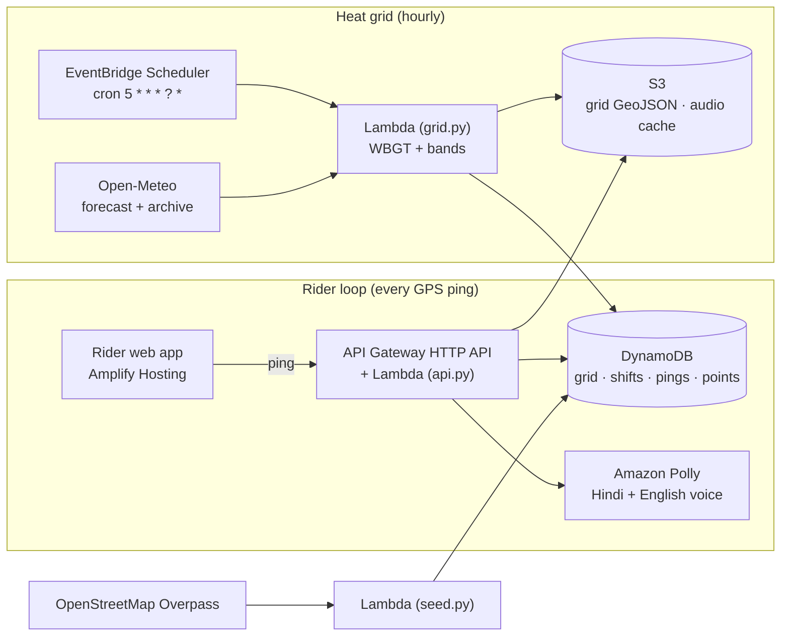

# HeatShield: a heat-safety companion for delivery riders

**Track:** Heat and Water · Environmental Hacks 2026 (Bharat Builds Tour)

Delivery riders spend the hottest hours of an Indian summer outdoors, are paid per order, and have no supervisor to tell them when to stop. HeatShield estimates each rider's **personal heat dose** from their GPS trail and a city-wide **WBGT heat grid**. It speaks up, in Hindi or English, only when a break costs them little or nothing:

| Nudge | When | What the rider hears |
| --- | --- | --- |
| **Idle** | Waiting for an order, heat dose building, shade or water within 300 m | Shade and water are close by while you wait |
| **On route** | Riding, dose high, a water point within 500 m *in the direction of travel* | Water point just ahead on your route |
| **Critical** | Dose at the limit, or the rider taps *I feel unwell* | Stop now; nearest rest point plus first-aid steps |
| **Break logged** | 10+ minutes stopped at a water or rest point | Break logged (the dose then recovers) |

**Design principle: breaks cost riders money, so we design for breaks that cost nothing.**

## Architecture



- **Heat grid:** the city is split into ~2 km cells (0.02°). Every hour, `grid.py` fetches temperature, humidity, wind and solar radiation for every cell centre, computes an outdoor WBGT estimate, assigns a band (green < 28 °C, yellow 28–31, red ≥ 31) and writes DynamoDB rows plus a GeoJSON layer per hour to S3.
- **Replay mode:** the same Lambda rebuilds any past day from Open-Meteo's archive, so the October demo can replay a real May heatwave afternoon. `{"mode":"scan"}` finds the hottest days for your city.
- **Heat dose (`core.py`):** each ping adds `minutes × band weight` (yellow 1, red 2); gaps are capped at 2 min; a break at a rest point recovers 2/min. Stationary, heading and break detection are pure functions with unit tests.
- **Water points:** seeded from OpenStreetMap (`amenity=drinking_water`, `fuel`, `toilets`, `shelter`) and crowdsourced by riders (one rider adds, a second confirms).
- **Voice:** Polly synthesises each clip once, caches it in S3, and the app plays it from memory. The app uses no data per nudge, which matters on phones that overheat.

AWS services: **Amplify Hosting, API Gateway, Lambda, EventBridge Scheduler, DynamoDB, S3, Polly**, deployed with **AWS SAM** (open source). Optional: **Amazon Location Service** map tiles (set `LOCATION_API_KEY`).

## Run it

```bash
# tests (no AWS, no dependencies)
python3 backend/tests/test_heatshield.py

# local UI with fake AWS
python3 scripts/local_server.py      # open http://localhost:8787/?demo=1&replay=1

# deploy to AWS (needs AWS CLI v2 + SAM CLI)
REPLAY_DATE=2024-05-03 ./scripts/deploy.sh
```

Pick a real replay date for your city first:

```bash
aws lambda invoke --function-name <GridFunctionName> --cli-binary-format raw-in-base64-out \
  --payload '{"mode":"scan","from":"2024-04-01","to":"2024-06-15"}' /dev/stdout
```

Other cities: set `BBOX=south,west,north,east`, `CITY` and the map `CENTER` in `web/config.js`.

**Demo mode:** open `/?demo=1&replay=1` and press *Run demo ride*. One simulated minute plays per second (`&speed=500` to go faster). The scripted ride is the same one the end-to-end test checks, so idle → on-route → break-logged fire in that order, then tap *I feel unwell* and *End shift*.

## Repository

```
template.yaml               SAM: 4 tables, bucket, HTTP API, 3 functions, hourly schedule
backend/src/core.py         WBGT, cells, heat dose, breaks, nudge rules (pure, tested)
backend/src/api.py          HTTP API router
backend/src/grid.py         hourly / replay / scan heat grid
backend/src/seed.py         OpenStreetMap water and rest points
backend/src/config.json     every threshold, in one place
backend/tests/              unit + end-to-end tests with an in-memory AWS fake
web/                        rider app (plain JS + MapLibre, no build step)
scripts/deploy.sh           build, deploy, warm data, bundle web for Amplify
scripts/local_server.py     offline UI development
```

## Honest limitations

- **WBGT is estimated, not measured.** We use the Australian Bureau of Meteorology shade approximation plus a capped direct-sun allowance (up to +3 °C at 1000 W/m²). Cells are ~2 km, so street-level hotspots are missed.
- **Thresholds are assumptions,** not clinical limits; they live in `config.json` for an occupational-health expert to set.
- **The web app tracks only while the screen is on** (we hold a wake lock). A production build would be a native app with background location.
- **No authentication:** riders get an anonymous ID and we store no names or phone numbers. Production needs Cognito and rate limits.
- OpenStreetMap water-point coverage in Indian cities is patchy; crowdsourcing fills the gap.

## AI tools used

Claude (Anthropic) was used for research, planning, and to write and review code, tests and docs. The team reviewed, ran and owns all code.

## Sources

- Lancet Countdown 2025, India data sheet: 247 billion potential labour hours lost to heat in 2024; construction 20% of losses.
- Telangana Gig and Platform Workers Union / HeatWatch survey: 16.87% of gig workers have access to shaded rest areas (reported by BW Businessworld, May 2026).
- Ministry of Labour and Employment heatwave advisory, 28 April 2026 (PIB): reschedule work hours, provide water and rest areas.
- Open-Meteo forecast and historical weather APIs; OpenStreetMap contributors (ODbL).
